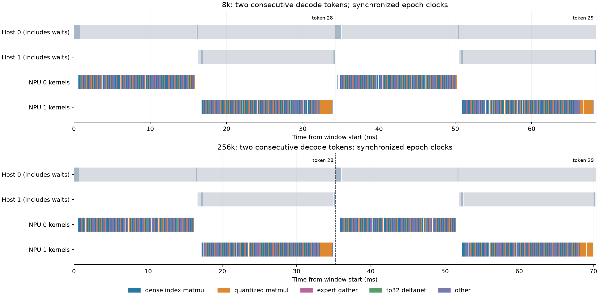

# r144 双进程对齐时间线与硬件计数器（r145 补采）

2026-11-12，192.168.18.206，2×910B4-1，物理3/5、容器0/1。采样实现为794a22e的r144，正式模型代码、权重、共享库、启动参数均未改。诊断副本仅给pipeline/worker加入计时范围和profiler RPC。BF16激活/KV、FP32状态，24+24两进程，262144窗口，hybrid传输和融合head保留。

本轮补采回答：正常runtime基线约33.35 / 34.22 ms；带timing的账本中约93%为设备任务执行区间。其余约7%是级内与外部间隙的合计，尚不能进一步精确归因为CPU调度、设备调度或IPC等待；本轮也没有做NPUGraph开关对照，不能声称已测得NPUGraph消除了多少百分比的Host开销。即使消除全部这些间隙，采样账本内的理论速度增益也只有约7.6% / 7.4%，不是已验证可实现的提速。不能用profiler设备耗时直接减无profiler TPOT来估算Host预算。

计数器与时间线更支持访存搬运、低batch/小kernel执行效率限制，而非Cube峰值算力或双卡大流量带宽饱和。该判断是本次计数器的综合推断；未测得kernel内有效带宽/峰值FLOPS的完整roofline，不能把全部NPU执行时间直接归为HBM瓶颈。

## 时间线账本

| 上下文 | 无采集前 / 后, ms | timing采集, ms | 设备忙 | 级内间隙 | 外部间隙 | 阶段间空档 |
|---|---:|---:|---:|---:|---:|---:|
| 8k | 33.398 / 33.296 | 34.143 | 31.720 | 1.130 | 1.293 | 0.720 |
| 256k | 34.251 / 34.187 | 34.910 | 32.500 | 1.094 | 1.315 | 0.740 |

时间单位均为每token毫秒。设备忙为AI Core/AI Vector/Memcpy区间的并集；级内间隙为两阶段包络并集减设备并集；外部间隙为token周期减阶段包络。三项严格闭合，跨卡执行重叠为0.000000 / 0.000000 ms。不把两卡利用率相加当单卡利用率，也不把等待另一阶段的空闲误判为Host喂数不足。

每个timing轮24步，按相邻完成时刻计23个周期；前后无profiler基线各16步。8k timing扰动约 2.39%；256k timing扰动约 2.02%。这些是直接Engine.generate驱动的runtime周期，含生成控制，但不含HTTP/SSE文本编码流程；与上一轮HTTP TPOT 33.78 / 34.45 ms口径不同。计数器轮8步，性能受PMU采集影响，不充当正常TPOT。

Host源仍有输入准备、图选择/回放、D2H同步、Pipe交接、H2D同步、greedy标量读取及返回。表中阶段间空档位于stage0最后设备任务与stage1第一设备任务之间；D2H/H2D设备任务本身另计设备忙，因此此列不是完整通信总耗时。CPU的transfer_wait/recv_wait/greedy_wait范围包含NPU执行等待，不能重复加到设备时间上，也不能都算CPU运算。

对齐依据：同机epoch与monotonic时钟、两进程共同token序号、CANN绝对时间。8k 最小往返 73.07 µs，子进程相对中点偏移 -3.84 µs; 256k 最小往返 67.12 µs，子进程相对中点偏移 -3.84 µs。没有为了闭合人工移动或缩放设备时间。coverage-audit.json检查各周期kernel签名数量一致、HBM时间窗覆盖和阶段先后关系。

`aligned/8k_timing.json`、`256k_timing.json`为完整Chrome Trace格式，包含两进程CPU范围与两卡kernel；`*_two_tokens.json`是两token窗口。`r144-dual-process-timeline.png`用于快速查看；灰色Host范围包含等待，不能按面积当作CPU忙碌。

## Cube / Vector、缓存与物理HBM

| 上下文 / 阶段 | Cube MAC周期占比 | Vector周期占比 | AIC MTE2周期占比 | L2读命中率 | HBM读 / token | HBM写 / token | HBM平均读 / 写 |
|---|---:|---:|---:|---:|---:|---:|---:|
| 8k / S0 | 8.54% | 20.96% | 70.03% | 32.57% | 4.515 GB | 0.707 GB | 135.0 / 21.1 GB/s |
| 8k / S1 | 8.27% | 29.88% | 63.33% | 45.91% | 6.236 GB | 1.015 GB | 186.5 / 30.4 GB/s |
| 256k / S0 | 8.77% | 20.65% | 70.32% | 33.27% | 4.738 GB | 0.697 GB | 138.4 / 20.4 GB/s |
| 256k / S1 | 8.46% | 29.44% | 64.57% | 46.11% | 6.326 GB | 1.166 GB | 184.8 / 34.1 GB/s |

以上各指标分轮采集，不是同一瞬间的联合计数。MAC/Vector/MTE2按对应Core total_cycles加权；它们可重叠，不能相加到100%。这是参与核的指令周期占比，不是整卡峰值FLOPS达成率。CANN的cube_utilization列是核心周期覆盖口径，不能当成MAC指令占比或BF16峰值利用率。

L2读命中率按aic/aiv的r0/r1命中计数总和除以命中+miss_allocate计数总和，保留原始计数与覆盖率，不采用各算子百分比简单平均。MemoryAccess逻辑数据量和Memory组带宽在summary.json中按算子类别列出；不能将GM读量直接当作穿透L2后的物理HBM字节。

### L2请求计数与逻辑流量

| 上下文 / 阶段 | L2读命中, 百万次/token | L2读miss_allocate, 百万次/token | GM逻辑读, GiB/token | GM逻辑写, GiB/token |
|---|---:|---:|---:|---:|
| 8k / S0 | 15.844 | 32.798 | 5.799 | 1.619 |
| 8k / S1 | 29.522 | 34.787 | 7.666 | 2.847 |
| 256k / S0 | 16.718 | 33.535 | 5.991 | 1.634 |
| 256k / S1 | 30.391 | 35.525 | 7.858 | 2.861 |

Memory组的四个`aic/aiv_l2_read/write_bw(GB/s)`字段在两种上下文、两个阶段均返回0，因此本轮直接L2 GB/s不可用，不能将其解释为零访问。上表提供有效的L2命中/缺失次数及独立MemoryAccess逻辑流量；KB按1024字节换算GiB，物理HBM表按十进制GB。两组是不同轮、不同连续位置的采样，不用L2命中率乘GM逻辑流量来反推物理HBM。没有把请求次数擅自换算成物理L2字节量。

物理HBM与PCIe使用单独的msprof系统采样：HBM请求100Hz、PCIe请求50Hz。只积分实际32个decode token对应的时间窗，排除工具启动、导出和空闲段；按导出单位MB/s积分。每卡四个HBM通道相加。工具hbm.csv的Average是四通道平均值，不能直接当整卡总带宽。读写相加也不能与纯读峰值直接比较。系统轮不同时运行算子PMU，避免采集资源争用。

本机历史连续HBM读基线约1447 GB/s。表中平均带宽包含该卡等待另一阶段的时间；低于这个基线并不排除特定kernel内的访存瓶颈。结合低MAC指令占比、较高MTE2占比与大量短kernel，当前证据更支持“数据搬运等待、访问/执行粒度效率”限制，不能表述为Cube算力跑满或HBM总线持续跑满。PCIe在hybrid decode中搬运约20KiB隐状态/阶段边界，固定交接延迟需要优化，但没有大流量传输饱和的证据。

PCIe吞吐采样字段在本次短decode窗口中均为0，无法可靠量化稀疏小消息传输；这不表示没有PCIe通信。nonpost_latency的单位是µs，不混入MB/s统计。判断大流量带宽不是首要限制，还依赖已核实的20KiB阶段载荷及拷贝/交接时间线，不能单凭零计数作结论。

本次timing记录每token稳定包含Stage0 1864、Stage1 1885，共3749个kernel。全部设备Memcpy区间并集约0.0215 ms/token，包含embedding、隐状态和标量等拷贝，不能全部称为IPC。阶段间空档约0.72 / 0.74 ms，固定同步/进程交接比纯拷贝执行时间更值得关注；这个空档也不是已分离出的纯IPC成本。

工具停止profiler时输出了RECORD状态警告；已按CPU token边界检查两卡全部目标周期的kernel数量/签名一致，20组阶段×指标检查通过，HBM采样时间窗覆盖超过99%。未使用不完整的Torch→ACL flow映射来补造设备事件。

## 采样与恢复

固定使用r144已验收的8064及262016输入token的两份HTTP消息，Engine.generate产生124个连续token；不复制整个256k缓存回滚。每轮位置在runs.json列明，未越过窗口。两轮输出与r144参考前缀一致性记录于8k/256k-output.json，未修改数值路径。

最初8k全部完成后，256k输入文件名不一致触发中断；独立恢复任务已实际恢复正式r144。修正入口后只续采256k，并保留8k数据，没有把失败启动算成性能结果。

正式服务在采样时暂停，manager和两份已确认的FNX watchdog停止。独立systemd到期恢复覆盖SSH断链；完成后通过原p275.sh重新HTTP ready，恢复manager并还原为一份正常watchdog，移除临时drop-in、恢复timer、租约及本轮完整ENV快照。所有诊断改动都在隔离副本，正式源码/ELF与采样前哈希核对。

原始目录：/models/fnx-diagnostics/r145-hardware-profile-20261112。完整traces和system原始文件保留服务器，不把权重、图缓存、完整ENV或凭据放入Git/交付包。profile_support.py、patch.py、profile_model.py及analyze.py可复核方法；输入文件、软件矩阵和正常服务配置须一致。硬件计数器解释依据CANN9.1的AiCMetrics、op_summary与系统HBM/PCIe字段，不把旧r141占比外推至r144。

恢复后另做一次fresh 8k正式HTTP检查：128输出token，完整回答与r144参考逐字节相同；TTFT 3.935 s，TPOT 33.88 ms。这是恢复验收单次测量，不替代r144三次中位数。记录见post-restore-http.json。

## 数据复核与字段依据

完整Chrome Trace、原始kernel/task CSV压缩包及全时窗HBM/PCIe计数器随证据包交付。`aligned/*_system_counters_full.csv`保留生成时间窗两侧采样点；按前值保持积分，与analyze.py一致。`system-summaries/`保留原工具汇总，但不用于代替decode有效窗的积分结果。SHA256SUMS列出交付文件哈希。

CPU分析复现：在含原始traces/和system/的服务器目录依次运行`python analyze.py`、`python audit.py`、`python finalize.py`；图形使用隔离plot-venv执行`python plot.py`。操作性脚本按实际采集留档，原始私密ENV已经移除；不把历史controller直接当无人值守复跑入口。完整原始文件留在上文服务器目录。

字段口径参见[CANN 9.1 AI Core指令占比、Memory、L2Cache与MemoryAccess定义](https://www.hiascend.com/doc_center/source/zh/CANNCommunityEdition/910/devaids/Profiling/atlasprofiling_16_0069.html)及[torch_npu AiCMetrics API](https://www.hiascend.com/document/detail/en/Pytorch/2610/apiref/customapi/docs/en/custom_APIs/torch_npu-profiler/torch_npu-profiler-AiCMetrics.md)。具体支持度以本次导出和上述无效字段说明为准。
